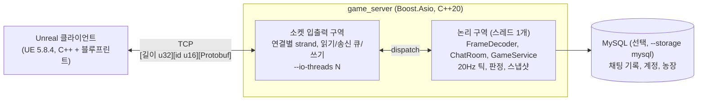

# Cross-Platform Game Server Lab

Boost.Asio 기반 C++20 게임 서버를 단계별로 만들고, **각 단계의 정확성과 성능을 재현 가능한 기록으로 남긴** 개인 프로젝트입니다. 패킷 송수신에서 시작해 채팅과 MySQL, 부하 측정, 서버가 상태를 소유하는 협동 게임(Unreal 5.8 클라이언트)까지 만들었습니다. 이 저장소의 핵심은 기능 목록보다 **"무엇을 가정했고, 무엇을 쟀고, 어디서 틀렸고, 어떻게 고쳤는가"의 기록**입니다.

> 상태: Windows 기준 1~4단계 구현과 측정 완료. **그 뒤에 계정(ID/비밀번호)과 농장 저장(MySQL: 집, 인벤토리, 누적 채집량)을 서버에 구현해 인메모리 저장소로 시험했습니다.** 실제 MySQL 대상 시험은 사용자가 실행해야 합니다. Unreal 로그인 화면은 C++, 커맨들릿 시험, 에디터 위젯 추가까지 끝났고 PIE 확인을 진행 중이며, 저장 부하 측정은 아직 안 했습니다([docs/persistence.md](docs/persistence.md)). 그 뒤 스타듀밸리 풍 콘텐츠(하루와 잠, 맵 여러 개, 농사, 경제, 제작)를 조각 단위로 진행 중이며, 진행 상태는 [docs/status.md](docs/status.md)에 있습니다. Linux 빌드는 아직 확인하지 않았습니다(보류). 성능 측정은 모두 **한 PC의 루프백**(서버와 부하 생성기가 코어를 나눠 씀), **저장 기능을 켜지 않은 구성**의 결과입니다.

## 결과 한눈에 보기

| 영역 | 결과 | 근거 |
| --- | --- | --- |
| 정확성 | `ctest` 685개 등록, 648개 통과(MySQL 대상 37개는 비밀번호가 없으면 건너뜀, 지금의 숫자는 [docs/status.md](docs/status.md). 채팅 저장소는 실제 MySQL로 13개 통과를 확인했고, 계정/농장 MySQL 시험은 아직 실행하지 못함). 통합 테스트는 입출력 스레드 4개로도 반복 | [CLAUDE.md](CLAUDE.md), [docs/stage2.md](docs/stage2.md) |
| 시험의 신뢰 | 코드를 일부러 망가뜨려 시험이 잡는지 확인(변형 검증): 서버 채집 20가지, 건설/충돌 30가지, 입출력 분리 3가지, Unreal 쪽 수십 가지. 처음에 놓친 것과 시험으로 만들 수 없던 것도 기록 | [docs/server-journey.md](docs/server-journey.md) |
| 단순 왕복(3단계) | Active **4,000연결(초당 4만 건)까지 3회 모두 합격**, 서버 스레드 1개의 처리량 상한 약 4.5만/s | [results/stage3/scaled.md](results/stage3/scaled.md) |
| 로그 레벨 | `debug`는 `info`보다 응답당 CPU **약 5~6배** (부하 측정은 `info`) | [results/stage3/exp1-loglevel.md](results/stage3/exp1-loglevel.md) |
| 게임 서버 병목 | 틱 시간의 **약 98%가 전송(Deliver)**, 한 번에 약 16.6 µs. 직렬화는 1% 미만 | [results/stage4/deliver-breakdown.md](results/stage4/deliver-breakdown.md) |
| **입출력 스레드 분리** | 같은 세션에서 분리 이전은 방 **400개까지**(500개 0/3), 입출력 스레드 2개는 **600개**, 4개는 **700개까지 3회 합격(상한 못 찾음)**. 틱 스레드 전송 시간 92% 감소, 서버 전체 CPU 약 25% 증가 | [results/stage4/io-threads.md](results/stage4/io-threads.md) |
| 철회한 결론 | "충돌이 방당 CPU를 15~27% 늘렸다"는 결론을 **철회**(속도와 충돌은 원인이 아니었고 측정한 날의 PC 상태 편차가 더 컸음) | [results/stage4/game-load-recheck.md](results/stage4/game-load-recheck.md) "정정" |
| Unreal 클라이언트 | 메뉴 → 방 → 이동 → 채집 → 집 짓기. 에디터 자동화(Unreal MCP)로 에셋을 만들고 로직은 C++에 둠. 에디터 두 창으로 한 방 접속 확인 | [docs/unreal-client-structure.md](docs/unreal-client-structure.md) |

수치 옆의 조건과 한계(같은 PC 루프백, Windows, 일부 실행에 PC 부하가 섞였을 가능성, 상한 미탐색)는 각 결과 문서에 함께 적었습니다. 측정 전에 합격 기준을 적고, 비교는 같은 세션에서 번갈아 실행하고, 한 번에 변수 하나만 바꿨습니다.

## 구조



- **서버가 상태와 판정을 소유한다.** 이동, 채집 거리와 쿨다운, 건설 가능 여부를 서버가 판정하고 클라이언트는 입력을 보내 서버 값을 그린다.
- **게임 로직은 스레드 하나, 소켓 입출력은 스레드 N개.** 두 구역은 `dispatch`로만 넘나든다. 설계 근거와 측정은 [docs/server-journey.md](docs/server-journey.md) 6절.
- 프레임 형식과 오류 처리 계약은 [docs/protocol.md](docs/protocol.md)가 기준이다.

## 단계별 요약

| 단계 | 내용 | 상태 | 문서 |
| --- | --- | --- | --- |
| 1. 패킷 송수신 | TCP 프레이밍(분할/합쳐진 프레임/비정상 길이), Protobuf Ping, 송신 큐, 통합 테스트 | Windows 완료, Linux 보류 | [stage1](docs/stage1.md), [protocol](docs/protocol.md) |
| 2. 채팅 + MySQL | 입장/퇴장/방 전파/기록 조회, `ChatRepository` 인터페이스, Boost.MySQL, DB 장애 시 동작 | Windows 완료 | [stage2](docs/stage2.md), [protocol-chat](docs/protocol-chat.md) |
| 3. 수용 규모 측정 | Idle/Active 워크로드, p50/p95/p99, 다중 스레드 부하 생성기, 로그 레벨과 Nagle 비교 | 기준·확장·실험 1~2 완료 (실험 3 "스레드 수"는 계획대로 하지 않았고, 같은 방향의 개선을 4단계에서 입출력 스레드 분리로 측정) | [stage3](docs/stage3.md), [results/stage3](results/stage3/) |
| 4. 게임 | 방 코드 입장(최대 4명), 서버 판정 이동 20Hz, 자원 채집, 집 짓기와 이동 충돌, 건설 구역 분리 | 서버와 Unreal C++ 완료, 에디터 쪽 확인 일부 남음 | [stage4](docs/stage4.md), [stage4-gather](docs/stage4-gather.md), [content-roadmap](docs/content-roadmap.md) |
| 5. 계정과 농장 저장 | ID/비밀번호(Argon2id 해시, 해시는 일꾼 스레드), 로그인한 사람의 방 = 내 농장(집, 인벤토리, 누적 기록을 MySQL에 저장, 건설은 바로·채집은 모아서·실패하면 재시도), 게스트 유지 | 서버 구현과 인메모리 시험 완료. 실제 MySQL 시험, Unreal, 부하 측정은 남음 | [persistence](docs/persistence.md) |
| 4-성능. 부하 측정과 개선 | 방 500개 한계 발견 → 철회 → 병목 분해 → 입출력 스레드 분리 | 완료 | [server-journey](docs/server-journey.md), [results/stage4](results/stage4/) |
| Unreal 연동 | 접속 계층 → 메시지 계층 → 서브시스템 → 게임 → UMG, MCP 작업 분담 | 최소판 완료 | [unreal-client-structure](docs/unreal-client-structure.md), [unreal-client](docs/unreal-client.md) |

## 시행착오 하이라이트

전체 이야기는 [docs/server-journey.md](docs/server-journey.md)입니다.

1. **측정 도구가 먼저 한계에 닿았다.** 연결 5,000개 이상에서 나온 큰 지연은 서버가 아니라 부하 생성기 포화였다. 서버 수치로 적지 않고 생성기를 다중 스레드로 고쳐 다시 쟀다.
2. **결론을 두 번 철회했다.** 충돌 이후 "450개, CPU 15~27% 증가"는 원인 분해에서 속도와 충돌이 CPU를 바꾸지 않는다는 것이 드러나 철회했고, 이전/새 서버 비교는 배경 프로그램 때문에 무효 처리했다. 이후 실행 전 PC CPU 확인, 번갈아 실행, 진행 기록 같은 절차가 생겼다.
3. **최적화 전에 병목을 증명했다.** 틱 단계별 계측과 서버 밖 마이크로벤치로 비용이 소켓 송신 시스템 호출임을 확인하고, 직렬화/객체 풀/충돌 격자 분할은 증거(각각 1% 안팎)로 버렸다.
4. **구조를 바꿔 방 수를 늘렸다.** 소켓 입출력만 strand 기반 스레드로 분리해 같은 세션 기준 400개 → 600개(스레드 2) / 700개 이상(스레드 4). 입출력 스레드 1개는 오히려 입력 반영 지연이 6~11초로 늘어 **쓰면 안 되는 설정**이었고, 이는 도착 간격만 봤다면 놓쳤을 문제를 합격 기준(입력 반영 지연)이 잡은 사례다.
5. **소멸 순서 버그**로 프로세스가 가끔 죽던 문제를 증거를 늘려가며 진단하고(버퍼 없는 출력, terminate 핸들러, CRT 보고), 풀 공유 소유와 소멸 시 flush로 고쳤다. 60회 반복 실패 0.

## 문서 지도

| 문서 | 내용 |
| --- | --- |
| [project.md](project.md) | 목표, 기술 선택, 단계별 로드맵, 범위 |
| [docs/server-journey.md](docs/server-journey.md) | **서버 시행착오 기록**: 가설, 측정, 철회, 개선, 버그 |
| [docs/persistence.md](docs/persistence.md) | **계정과 농장 저장(MySQL)**: 설계 결정, 스키마, 저장 규칙, 프로토콜, 구현 결과, 시험과 변형 검증, 한계 |
| [docs/unreal-client-structure.md](docs/unreal-client-structure.md) | **Unreal 클라이언트 구조와 MCP 작업 방식** |
| [docs/protocol.md](docs/protocol.md) | 1단계 TCP 패킷 형식과 오류 처리 계약 |
| [docs/validation.md](docs/validation.md) | 기능 검증, 부하 측정, 비교 실험 기록 방식 |
| [docs/stage1.md](docs/stage1.md) | 1단계 구성, 실행 방법, 검증 결과, 겪은 문제, 알려진 제한 |
| [docs/stage2.md](docs/stage2.md), [docs/protocol-chat.md](docs/protocol-chat.md) | 2단계 결정 기록, MySQL 준비, 채팅 프로토콜 |
| [docs/stage3.md](docs/stage3.md) | 3단계 측정 계획과 합격 기준, 측정 도구에서 겪은 문제 |
| [docs/game-plan.md](docs/game-plan.md) | 게임 기획 초안(1~4인 협동 농장)과 서버 영향 |
| [docs/stage4.md](docs/stage4.md) | 4단계 게임 서버: 범위, 프로토콜(ID 100~), 기본값, 검증, 부하·입출력 분리 계획과 결과 |
| [docs/stage4-gather.md](docs/stage4-gather.md), [docs/content-roadmap.md](docs/content-roadmap.md) | 자원 채집, 집 짓기(이동 충돌, 구역 분리) 설계와 검증 |
| [docs/unreal-client.md](docs/unreal-client.md) | Unreal 접속 절차, 기준 바이트, Protobuf 연동, 계층별 시험, 겪은 문제 |
| [results/stage3/](results/stage3/), [results/stage4/](results/stage4/) | 측정 결과 문서, 원본 CSV와 로그(`raw/`), 실행·집계 스크립트 |
| [CLAUDE.md](CLAUDE.md) | 개발 규칙과 확인된 빌드·실행 명령 (작업 도구용 안내) |

## 빠른 시작 (Windows)

환경 준비(Visual Studio 2022, vcpkg)와 빌드 명령은 [CLAUDE.md](CLAUDE.md)의 "명령" 절을 따릅니다. 빌드 후 서버와 시험:

```bash
build\windows-local\Debug\game_server.exe --port 7777
build\windows-local\Debug\ping_client.exe --port 7777 --count 5
ctest --test-dir build\windows-local -C Debug
```

게임은 터미널을 여러 개 열어 직접 체험할 수 있습니다(방 코드로 입장해 서로의 이동을 본다).

```bash
build\windows-local\Release\game_server.exe --port 7777 --log-level info
build\windows-local\Release\game_client.exe --port 7777 --create --nick alice
build\windows-local\Release\game_client.exe --port 7777 --join <출력된 방 코드> --nick bob
```

입출력 스레드 분리는 서버 옵션 `--io-threads N`(기본 0)으로 켭니다. 부하 측정은 `game_load_client`와 `results/stage4/run-load-io.ps1`, 채팅은 `chat_client`, Unreal 클라이언트 실행은 [docs/unreal-client-structure.md](docs/unreal-client-structure.md)와 [docs/unreal-client.md](docs/unreal-client.md)를 보세요.

## 알려진 한계

- Linux 빌드와 측정을 하지 않았습니다. 모든 수치는 Windows, Release, 한 PC의 루프백입니다.
- 입출력 분리의 기본값은 0입니다. `--io-threads 4`의 상한을 찾지 못했고(사전 규칙이 700개까지), 느린 연결에 낡은 스냅샷이 쌓이는 문제는 고치지 않았습니다.
- Unreal 쪽은 노드/구조물 액터의 모양, 건설 모드 마우스 입력, HUD 표시를 자동으로 확인하지 못했고, 3~4명 동시 접속과 패키징한 빌드는 시험하지 않았습니다. 미니맵은 Unreal 저장소에 미커밋 상태입니다.
- 게임 규칙 값(맵 크기, 속도, 건설 비용 등)은 임의 기본값이며 `PlayConfig`에서 바꿉니다.

## 남은 일 (선택)

전체 목록과 누가 할 일인지는 [docs/status.md](docs/status.md)가 기준입니다. 요약:

0. **콘텐츠:** 조각 2(하루와 잠) 서버 마무리와 Unreal, 조각 2.5(맵 여러 개), 그다음 농사, 경제, 제작([docs/game-plan.md](docs/game-plan.md)).
1. **계정과 농장 저장:** 실제 MySQL 시험 실행(`account_mysql_test`, 사용자가 비밀번호를 환경변수로 줌), Unreal 로그인/가입 화면의 PIE 확인 마무리(P3), 저장 켬/끔 부하와 로그인 폭주 측정(P4), TLS(비밀번호가 지금은 평문으로 전송됨).
2. `--io-threads 4`의 상한 재측정(새 계획 필요)과 느린 연결의 스냅샷 대체 처리.
3. Linux 빌드와 측정(1단계 이후 보류).
4. Unreal 비동기 접속, 3~4명 동시 접속, 패키징한 빌드.
