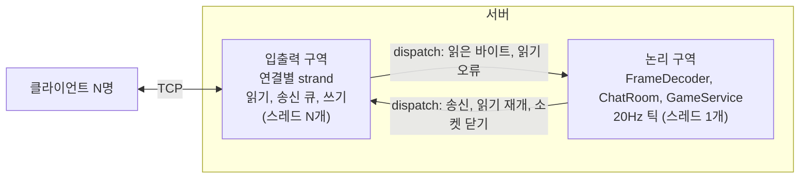

# 서버 시행착오 기록: 가설, 측정, 철회, 개선

이 문서는 서버를 만들면서 **무엇을 가정했고, 무엇을 쟀고, 어디서 틀렸고, 어떻게 고쳤는지**를 시간 순서로 모은 것이다. 결과만 모은 표는 [results/](../results/)에, 설계 근거는 단계별 문서에 있고 여기서는 그 사이의 이야기를 잇는다. 숫자는 모두 해당 결과 문서에서 가져왔고, 출처 링크를 달았다.

한 줄 요약: **방 500개에서 불합격하던 서버를, 병목이 "소켓 송신 시스템 호출"이라는 증거를 먼저 만든 뒤 소켓 입출력만 별도 스레드로 분리해 700개 이상까지 합격시켰다.** 그 과정에서 두 번 결론을 철회했고, 한 번은 측정 환경 오염을, 한 번은 시험이 버그를 놓친 것을 잡았다.

## 1. 한눈에 보는 연표

| # | 질문 | 한 일 | 결과 | 결정 | 출처 |
| ---: | --- | --- | --- | --- | --- |
| 1 | 기준 구성은 연결을 몇 개까지 받는가 | Idle/Active 워크로드, 연결 100~10,000 | 5,000 이상은 **생성기가 먼저 포화**되어 판정 불가 | 서버 수치로 쓰지 않고, 생성기를 다중 스레드로 바꿔 재측정 | [baseline](../results/stage3/baseline.md) |
| 2 | 서버의 진짜 한계는 | 다중 스레드 생성기로 재측정 | Active **4,000연결 3/3 합격**, 5,000 1/3, 7,500부터 과부하. 서버 스레드 1개의 처리량 상한 약 4.5만/s | 병목은 서버 스레드 1개로 기록 | [scaled](../results/stage3/scaled.md) |
| 3 | `debug` 로그는 얼마나 비싼가 | 로그 레벨 하나만 바꿔 비교 | 응답당 CPU가 `info`의 **약 5~6배** | 부하 측정은 `info`로 고정 | [exp1](../results/stage3/exp1-loglevel.md) |
| 4 | Nagle를 끄면 빨라지는가 | `TCP_NODELAY` 켬/끔 비교 | 끄는 이득 없음 | 켬 유지 | [exp2](../results/stage3/exp2-nodelay.md) |
| 5 | 게임 서버는 방 몇 개를 받는가 | 방 25~700개, 방당 4명, 20Hz 스냅샷 | 500개 3/3 합격, 600개 불합격. 한계에서는 시뮬레이션 대신 **스냅샷을 건너뛰는** 방식으로 무너짐 | 최대 안정 500개로 기록 | [game-load](../results/stage4/game-load.md) |
| 6 | 충돌과 속도 360을 넣은 뒤에도 500개인가 | 같은 계획으로 재측정 | 450 합격, 500 불합격 (방당 CPU +15~27%로 보임) | **나중에 철회** (7, 8) | [game-load-recheck](../results/stage4/game-load-recheck.md) |
| 7 | CPU 증가의 원인은 속도인가 충돌인가 | 같은 세션에서 속도/충돌을 번갈아 되돌림 | **둘 다 아님**(CPU 61~64%로 동일). 그런데 같은 코드가 세션마다 60.7%, 70.7%, 84.3% | 6의 결론 철회 | [deliver-breakdown](../results/stage4/deliver-breakdown.md) |
| 8 | 이전/새 서버를 같은 세션에서 비교 | 번갈아 실행 | **배경 프로그램(게임)이 CPU를 써서 이전 서버마저 불합격 → 비교 무효** | 결론에 쓰지 않고 기록만 남김 | [game-load-recheck](../results/stage4/game-load-recheck.md) "정정" |
| 9 | 서버 시간은 어디에 쓰이는가 | 틱 단계별 계측 + 서버 밖 마이크로벤치 | **전송(Deliver)이 틱의 약 98%**, 한 번에 약 16.6 µs. 직렬화+프레임은 1% 미만 | 직렬화·풀·충돌 최적화 후보를 **버림**, 송신을 분리하는 후보 A만 남김 | [deliver-breakdown](../results/stage4/deliver-breakdown.md) |
| 10 | 송신을 입출력 스레드로 넘기면 | 후보 A 구현, 5개 조건을 같은 세션에서 번갈아 측정 | 분리 이전 500개 0/3 → **`IO2` 600개, `IO4` 700개까지 3/3** | 구현은 유지, 기본값은 0 | [io-threads](../results/stage4/io-threads.md) |

## 2. 3단계: 측정 도구를 먼저 의심했다

기준 측정에서 연결 5,000개와 10,000개의 p99 지연이 130~230 ms로 나왔다. 서버가 느린 것처럼 보이지만 같은 실행에서 **부하 생성기의 스케줄 지연이 수 초~십수 초, 생성기 CPU가 103% 이상**이었다. 생성기(스레드 1개)가 먼저 포화된 것이다. 그 지연을 서버 수치로 적지 않고 "판정 불가"로 남겼다([baseline](../results/stage3/baseline.md)).

생성기를 스레드 여러 개로 고친 뒤 다시 쟀더니 처음으로 서버의 한계가 보였다. 7,500연결부터는 서버 CPU가 99%에 붙고 처리량이 오히려 줄었다(약 4.5만/s → 3.9만/s), 응답이 쌓이고 메모리가 늘었다([scaled](../results/stage3/scaled.md)). 이때 만든 규칙이 이후 모든 측정에 쓰였다.

- 합격 기준은 **측정 전에** 문서에 적는다. 결과를 보고 기준을 바꾸지 않는다.
- 생성기가 포화되면 서버 결과로 인정하지 않는다(종료 코드 3).
- 비교 실험은 한 번에 변수 하나, 조건당 3회, 매 실행 새 서버 프로세스.
- 조건을 추가하면 추가했다는 사실과 이유를 결과 문서에 적는다(예: 500, 600, 700개 추가).

로그 레벨과 Nagle 실험은 "그럴 것 같은" 추측을 수치로 확인한 사례다. `debug`는 연결 500개(초당 5,000건)에서 서버 CPU가 12.8%에서 73.0%로 올랐다. 반대로 Nagle는 끄면 빨라질 것이라는 흔한 믿음과 달리 차이가 없었고, 켠 상태를 유지했다.

## 3. 4단계: 한계를 찾았고, 한계의 모양을 봤다

방 25개부터 700개까지(방당 4명, 입력 초당 10번, 서버는 20Hz 스냅샷) 쟀다. 합격 기준은 도착 간격 p99, 입력 반영 p99(100 ms 이하), 누락 스냅샷 비율(1% 이하) 등이다.

| 방 | 서버 CPU | 결과 |
| ---: | ---: | --- |
| 400 | 70.7% | 합격 3/3 |
| 500 | 86.5% | 합격 3/3 (도착 간격 p99 53 ms, 입력 반영 p99 83 ms) |
| 600 | 97.9% | 불합격 3/3 (누락 4~8%) |
| 700 | 98.5% | 불합격 3/3 (누락 21~28%) |

서버는 부하를 넘기면 **서버 시뮬레이션 시간은 지키고 스냅샷이 줄어든다**(600개 이상에서도 처리한 틱 수는 약 585~618개로 30초 x 20Hz = 600과 비슷). 위치 계산은 현실 시간을 따라가고 화면 갱신이 거칠어지도록 설계한 동작이고, 정합성 위반은 과부하에서도 0건이었다.

## 4. 철회한 결론 두 가지

이 프로젝트에서 가장 값진 기록이다. 측정을 믿기 전에 환경을 의심해야 하는 이유가 여기 있다.

### 4.1 "충돌 때문에 방당 CPU가 15~27% 늘었다" (철회)

이동 충돌, 건설 구역, 속도 360이 들어간 뒤 같은 기준으로 다시 재면 **450개 합격, 500개 불합격**이었다. 방당 CPU도 늘어 보여서(예: 방 400개에서 0.18% → 0.21%) 충돌 계산 탓이라 해석했다.

원인을 가르려고 같은 세션에서 속도 360/300과 충돌 켬/끔을 번갈아 쟀다(방 400개). 서버 CPU는 **60.7 / 61.9 / 61.1 / 63.5%** 로 모두 같았다. 속도도 충돌도 원인이 아니었다. 더 이상한 점은 같은 새 서버의 방 400개 CPU가 세션마다 **60.7%, 70.7%, 84.3%** 로 달랐다는 것이다. 코드 변경의 효과보다 측정한 날의 PC 상태 편차(20% 넘게)가 컸다. 그래서 "450개", "15~27% 증가"를 철회하고 결과 문서에 "정정" 절을 남겼다.

### 4.2 이전/새 서버의 같은 세션 비교 (무효)

그렇다면 이전 서버와 새 서버를 같은 세션에서 번갈아 재면 되겠다고 계획했는데, 그 세션에서 사용자가 게임을 하고 있었다. 이전에 방 500개를 합격했던 이전 서버마저 3회 모두 불합격했고(서버 CPU 93~96%), 새 서버는 생성기 포화로 판정 불가였다. 이 실행들은 `game-load-ab.csv`에 남기되 **결론에 쓰지 않는다.** "이전 서버가 이전과 다르게 불합격했다"는 사실이 곧 "측정한 날의 PC 상태가 결과를 바꾼다"는 증거다.

이 일 뒤로 바뀐 절차:

1. 측정 전에 PC 전체 CPU를 5초 평균으로 재서 10% 이하일 때만 실행을 시작한다(`run-load-io.ps1`).
2. 매 실행 전후의 PC CPU, 상위 프로세스를 진행 기록에 남긴다.
3. 비교 조건은 한 바퀴씩 **번갈아** 실행한다(조건 A 한 벌, B 한 벌이 아니라 A, B, C를 3바퀴).
4. 오염이 의심되는 실행을 임의로 빼지 않는다. 계획의 규칙대로 집계하고, 의심은 "알려진 한계"에 적는다.

## 5. 병목을 증명하기 전에는 최적화하지 않았다

철회 뒤에 "방 수를 늘리려면 무엇을 고쳐야 하는가"를 추측하지 않고 **서버 시간을 쪼개서** 봤다.

**(1) 틱 단계별 계측(방 400개, 12회 중앙값)**

| 단계 | ms/s | 틱 시간 비율 |
| --- | ---: | ---: |
| 이동 계산 | 3.9 | 0.7% |
| 재생/완공 갱신 | 1.1 | 0.2% |
| 메시지 구성 | 6.3 | 1.2% |
| **전송 (Deliver)** | **532.7** | **97.9%** |

**(2) 서버 밖 마이크로벤치(`bench_deliver`)**: 스냅샷과 같은 모양의 메시지로 200,000회씩 세 번 쟀다.

| 항목 | 한 번당 |
| --- | ---: |
| 직렬화 | 약 0.06 µs |
| 프레임 인코딩 | 약 0.04~0.07 µs |
| 송신 (`async_write` 연쇄) | 약 13.7~14.2 µs |
| 송신 (`write` 시스템 호출만) | 약 17.3~17.6 µs |

서버에서 잰 전송 한 번(약 16.6 µs)과 벤치의 송신 비용이 일치했다. **병목은 소켓 송신 시스템 호출**이다. 방 500개는 초당 40,000번의 송신이고 한 번에 14~17 µs면 한 코어의 56~70%다.

이 증거로 **버린 후보**:

| 후보 | 이유 |
| --- | --- |
| 방 단위로 직렬화를 한 번만 | 직렬화는 송신의 1% 미만 |
| 메시지 객체 풀 | 같은 이유 |
| 이동 계산 최적화 | 틱의 0.7% |
| 충돌 격자 분할(spatial grid) | 충돌은 틱의 0.5% 안팎 |

남은 후보가 **A. 송신(소켓 입출력)을 일꾼 스레드로 넘기기**였다. 후보 B(변하지 않은 스냅샷 생략), C(스냅샷 10Hz), D(scatter-gather)는 부하 특성이나 조작감 결정이 필요해 지금은 하지 않았다.

## 6. 개선 후보 A: 입출력 스레드 분리

게임 로직(방, 이동, 채집, 건설)은 **스레드 1개 그대로** 두고 소켓 읽기/쓰기만 `--io-threads N`개 스레드가 연결별 `strand`로 나눠 맡게 했다. 상세 설계는 [stage4.md](stage4.md)의 "송신 스레드 분리" 절이다.

핵심 설계 결정:

- **구역을 가르고 `dispatch`로만 넘나든다.** 논리 구역의 객체(디코더, 방, 게임 서비스, 세션 목록)는 스레드 안전하지 않아도 되도록 로직 스레드 하나에서만 만진다. `--io-threads 0`이면 두 구역이 같은 `io_context`를 써서 `dispatch`가 그 자리에서 실행된다(기본값, 기존 동작과 같은 모양).
- **읽기는 한 번에 하나만 걸고**, 논리 구역이 처리를 끝낸 뒤에 다음 읽기를 건다. 버퍼를 복사하지 않고 TCP 역압(backpressure)도 유지된다.
- **직렬화는 로직 스레드에서 한 번**, 송신 큐와 `async_write`는 strand에서 한다.
- 송신 큐 한도 초과(느린 클라이언트)는 strand 쪽에서 감지해 해당 연결만 닫는다.

### 측정 결과 (같은 세션에서 5개 조건을 번갈아, 조건당 3회)

합격 기준은 4단계 부하 측정 계획의 것 그대로이고 측정 전에 [stage4.md](stage4.md)에 적었다. 조건: `PRE`(분리 이전 서버, 게임 코드 동일), `IO0`(새 코드, `--io-threads 0`), `IO1`, `IO2`, `IO4`(`--io-threads` 1, 2, 4).

| 방 | PRE | IO0 | IO1 | IO2 | IO4 |
| ---: | :-: | :-: | :-: | :-: | :-: |
| 400 | 3/3 | 2/3 | 1/3 | 3/3 | 3/3 |
| 500 | **0/3** | 0/3 | 0/3 | **3/3** | **3/3** |
| 600 | 0/3 | 0/3 | 0/3 | **3/3** | **3/3** |
| 700 | (측정 안 함) | (측정 안 함) | (측정 안 함) | 1/3 | **3/3** |

규칙에 따라 600개를 3회 모두 통과한 조건만 700개를 더 쟀다. `IO4`는 700개에서도 3/3이었고 **상한은 찾지 못했다**(사전 규칙이 700까지만 허용).

| 지표 (방 400개 중앙값) | PRE | IO2 | IO4 |
| --- | ---: | ---: | ---: |
| 틱 스레드 전송 시간 (ms/s) | 759 | 57 | 58 |
| 서버 프로세스 CPU (모든 스레드 합) | 84.9% | 105.3% | 105.8% |

- **틱 스레드의 전송 부담이 92% 줄었다**(기준: 30% 이상). 병목이 틱 스레드에서 소켓 송신을 하는 입출력 스레드로 옮겨 갔다.
- **대가가 있다:** 같은 부하를 처리하는 데 프로세스 전체 CPU가 약 25% 늘었다(strand와 완료 처리 비용).
- **`IO0`는 분리 이전보다 약간 나쁘다.** 구조(strand, 원자 변수, 읽기 완료를 한 번 더 넘김)의 비용이다. 그래서 기본값은 0이지만 "0이 분리 이전과 같다"고 말하지 않는다.
- **`IO1`은 쓰면 안 되는 설정이다.** 입출력 스레드 하나가 읽기와 송신 완료를 모두 맡아 포화되면, **누락 스냅샷은 0인데 입력 반영 지연이 6~11초**로 늘었다(500개 6.3초, 600개 11.1초). 읽기 완료가 송신 작업 뒤에 밀려 입력이 늦게 도착하는데, 논리 스레드는 낡은 스냅샷을 계속 연결 큐에 쌓는다. **도착 간격 p99만 봤다면 놓쳤을 문제**이고, 합격 기준에 입력 반영 지연을 넣어 두었기 때문에 잡혔다.

### 신중하게 읽어야 할 것

- **"500 → 700"의 정확한 의미.** 첫 측정(충돌 이전 서버)에서는 500개가 합격이었다. 하지만 같은 세션 비교(위 표)에서 분리 이전 서버는 **400개까지만 3/3**이고 500개는 0/3이다. 같은 코드 계열이라도 측정한 날에 따라 한계가 달라진다는 4.1의 교훈이 그대로 나타난 것이다. 그래서 개선 폭은 **같은 세션 안에서의 비교**로만 말한다: 분리 이전 400개 → `IO2` 600개, `IO4` 700개 이상.
- 방 700개 `IO2` 1회차는 실행 중 PC 평균 CPU가 72.9%(다른 실행은 31~41%)였고 상위 프로세스에 Unreal Editor가 있었다. 이 실행의 불합격은 PC 부하의 영향일 수 있어 "1/3"을 확정 결과로 읽지 않는다. 방 400개의 `IO0`, `IO1` 실패도 PC 부하와 섞였을 수 있다. 반면 500개와 600개는 3회가 모두 같은 방향이라 결론이 흔들리지 않는다.
- 서버와 부하 생성기가 **같은 PC의 코어를 나눠 쓰는 루프백**이다. 실제 네트워크에서의 송신 비용은 다를 수 있고 서버 전용 기계에서는 이득이 더 클 수도 있다. Windows, Release, 한 대의 결과이며 Linux 결과는 없다.
- 기본값은 여전히 `--io-threads 0`이다. 바꾸려면 스레드 수 선택과 아래 "느린 연결의 낡은 스냅샷 누적" 처리까지 정해야 한다.

## 7. 구현 중에 잡은 버그와 시험의 허점

### 7.1 소멸 순서 때문에 프로세스가 가끔 죽던 버그

입출력 스레드 4개로 통합 테스트를 반복하자 채팅 테스트가 **가끔** 종료 코드 3으로 죽고, Debug에서는 CRT 대화상자와 함께 멈췄다. 원인: 로직 `io_context`에 남아 있던 완료 핸들러가 나중에 `Session`을 해제하는데, 그 시점에는 `Server`와 입출력 풀이 이미 소멸해 있었다. 소켓 소멸자가 죽은 서비스를 건드린 것이다.

진단은 추측 대신 증거를 늘려서 했다: 표준 출력을 버퍼 없이 바꾸고, `std::terminate` 핸들러가 예외를 출력하게 하고, Debug CRT 보고를 stderr로 보내고, 임시로 TRACE를 찍었다(원인을 찾은 뒤 제거). 수정은 두 가지다.

1. 세션이 입출력 풀을 **공유 소유**(`io_keepalive`)해서 소켓이 자기 `io_context`보다 오래 살지 않게 했다.
2. `~Server`에서 풀 보호기를 풀고, 스레드를 합류시킨 뒤 `restart()` + `poll()`로 남은 핸들러를 비운다(세션 ↔ 풀 소유 순환을 끊는다).

수정 뒤 60회 반복에서 실패 0건이었다. 이 시험은 `_io4` ctest 항목으로 남아, 이후 모든 통합 시나리오가 입출력 스레드 4개로도 반복된다.

### 7.2 변형 검증에서 시험이 버그를 놓친 경우

"시험이 통과한다"가 "시험이 쓸모 있다"는 뜻은 아니라서, 코드를 일부러 망가뜨려 시험이 잡는지 확인했다(변형 검증). 결과:

- 채집 서버 20가지 변형 중 **처음에는 2가지를 놓쳤다**(거리 판정에서 y축 무시가 통과, 시작 영역 변형은 패턴이 안 맞아 적용 안 됨). 시험 `ReachUsesBothAxes`를 추가하고 패턴을 고쳐 둘 다 잡았다.
- 건설과 충돌 서버 30가지 변형 중 **처음에는 3가지를 놓쳤다.** "벽을 따라 미끄러지지 않기" 변형은 시험을 고치다가 벽에 닿기 전에 끝나게 만들어 의미를 잃은 상태였고, 겹침 판정의 `<`를 `<=`로 바꾼 변형은 "정확히 닿는 경계"를 시험하지 않아서 통과했다. 둘 다 시험을 고쳐 잡았다. 나머지 1가지(NaN/무한대 검사 삭제)는 지워도 NaN 좌표가 `std::clamp` 때문에 건설자 몸과 "겹침"으로 판정되어 같은 결과가 나오는 **동등 변형**이라 잡히지 않는 것이 맞고, 그렇게 기록한 뒤 방어용 검사는 남겼다.
- 입출력 분리 변형 3가지는 모두 잡았다.
- Unreal 쪽: 처음 돌린 변형 검증이 실행 도구가 한글 로그를 잘못 읽어 **"잡힘"이라고 거짓으로** 나왔다. 통과 건수가 0으로 찍힌 것을 보고 알아차려 인코딩을 고치고 전부 다시 돌렸다.
- Unreal 클라이언트 메시지 계층 변형 9가지 중 1가지("전송 실패한 입력 번호도 올림")는 **잡지 못했고**, 시험으로 만들 수 없는 방어 코드라서 그렇게 적었다.

### 7.3 사소하지만 시간을 쓴 것

- PowerShell이 따옴표 없는 `-host=127.0.0.1`을 점에서 쪼갰다. 처음엔 Unreal의 `FParse` 탓으로 짐작하고 파서를 바꿨는데 효과가 없었고 원인은 셸이었다(작은따옴표로 해결).
- `-RoomsA 300,450`을 PowerShell이 하나의 숫자 `300450`으로 읽어 잘못된 값으로 한 번 실행했다. 곧바로 중단하고 생성한 프로세스만 번호로 종료한 뒤 기록을 지우고 다시 돌렸다.
- 집계 스크립트의 구간 경계를 "측정 종료 이후 첫 통계 줄"로 잡았더니 측정 뒤 연결 정리 구간이 섞여 틱 건너뜀이 합격 기준을 넘는 것처럼 보였다. 클라이언트가 본 최대 간격과 맞지 않는 것으로 알아차려 "측정 종료 이전 마지막 줄"로 고치고, 정리 구간 값은 따로 적었다(원인이 확인된 집계 오류의 수정임을 문서에 명시).
- 로그 라벨의 `-` 때문에 집계 스크립트의 라벨 파싱이 깨져(`io-r700`) `rsplit`으로 고쳤다.

## 8. 아직 하지 않은 것

- **느린 연결에 낡은 스냅샷을 계속 쌓는 문제**(`IO1`에서 드러남): 연결의 송신 큐가 깊으면 새 스냅샷으로 대체하거나 건너뛰는 처리가 필요하다. 후속 설계 후보이며 구현하지 않았다.
- **`IO4`의 상한**: 사전 규칙이 700개까지만 허용했다. 더 크게 재려면 새 계획을 먼저 써야 한다.
- 기본 `--io-threads` 값과 스레드 수 선택 기준.
- 분리 이전 서버를 포함한 전체 재현: 비교용 이전 서버 소스는 커밋 `03722ec`의 `session.*`, `server.*`다.
- Linux 빌드와 측정(1단계 이후 계속 보류).

## 9. 계정과 농장 저장(MySQL)에서 시험이 잡은 것

계정과 농장 저장([persistence.md](persistence.md))을 구현하면서도 같은 방식(시험, 변형 검증, 한계 기록)을 썼다. 이 과정의 기록이다.

- **변형 검증의 판정 자체가 틀렸다(스크립트 버그).** 변형 19가지를 자동으로 적용하는 스크립트가 처음에는 모든 변형을 "잡힘"이라고 보고했다. 서비스와 무관한 시험까지 실패로 나온 것을 보고 의심했고, 원인은 **원복할 때 `Copy-Item`이 옛 수정 시각을 그대로 복사해 MSBuild가 원복된 파일을 다시 빌드하지 않아** 첫 변형이 바이너리에 남아 있던 것이었다. 원복 뒤에 수정 시각을 갱신하고, 시작 전에 원본이 전부 통과하는지 확인하도록 고쳐 다시 돌렸다(19가지 중 17가지 잡힘, 2가지는 단독으로는 동등 변형이고 합친 변형은 잡힘). 이후 농장 변형 검증(22가지 중 21가지 잡힘)도 같은 도구를 썼다.
- **시험이 설계 결함을 잡았다.** 농장을 여는 도중(저장소 응답을 기다리는 동안) 연결이 끊기면 끊긴 연결을 위해 방이 만들어지고 있었다. 연결이 끊길 때 "여는 중" 표시를 지우지 않은 것이 원인이었다("끊김 도중 열기" 통합 시험이 방이 1개 남는 것으로 드러냈다).
- **살아남은 변형은 시험이 약하다는 증거였다.** "새 농장 코드를 만드는 도중 예약하지 않음" 변형이 처음에는 잡히지 않았다. 코드가 만들어진 뒤에 다시 예약하기 때문에 결과가 같았고, **만드는 도중에 게스트가 같은 코드를 가져가는 창**을 확인하는 시험이 없었다. 저장소 응답을 늦춰 그 창을 재현하는 시험을 추가해 잡았다.
- **저장 방식을 "절대값 + 쓰기 대기열"로 고른 이유.** 채집은 초당 여러 번 일어나 DB에 그대로 쓰면 쓰기가 폭증한다. 변경분(증가량)을 쌓으면 실패 뒤 재시도가 두 번 반영될 위험이 있어, "지금의 값"을 덮어쓰는 방식으로 정했다. 덮어쓰기는 같은 값을 다시 써도 결과가 같아서(멱등) 실패한 저장을 그대로 다시 보낼 수 있고, 저장소가 요청을 순서대로 처리하면 나중 값이 이긴다. 저장 중에 새 값이 들어오면 실패한 오래된 값이 새 값을 덮지 않도록 하는 시험이 있다.
- **쓰지 않은 측정.** 저장을 켰을 때의 부하(방 수, 틱 시간)와 로그인 폭주가 틱을 미는지는 **측정하지 않았다**(P4). 저장 기능을 켠 구성의 성능 수치는 어디에도 없고, 기존 부하 측정은 저장을 켜지 않은 서버의 결과다.

## 10. 이 과정에서 배운 것

1. **합격 기준을 측정 전에 쓴다.** 결과를 본 뒤 기준을 바꾸면 모든 숫자가 의심스러워진다. 입력 반영 지연 기준이 `IO1`의 숨은 문제를 잡았다.
2. **측정 도구와 환경을 먼저 의심한다.** 생성기 포화, 배경 프로그램, 세션별 편차가 코드 변경보다 컸다. 같은 세션 안에서 번갈아 재고, 실행 전 PC 상태를 기록한다.
3. **철회를 두려워하지 않는다.** 잘못된 결론을 지우지 않고 "정정"으로 남기면 그 자체가 이 프로젝트의 근거가 된다.
4. **최적화는 병목 증거 뒤에.** 직렬화, 풀, 충돌 격자는 그럴듯했지만 증거가 1%라고 말했다.
5. **시험도 시험한다.** 변형 검증으로 시험의 구멍을 찾았다(채집 변형 20개 중 2개, 건설과 충돌 변형 30개 중 3개를 처음에는 놓쳤고, 그중 1개는 동등 변형이었다).
6. **한계는 숫자 옆에 같이 쓴다.** 같은 PC 루프백, Windows 전용, 일부 실행의 PC 부하 혼입, 상한 미탐색을 결과 표 바로 아래에 적었다.
