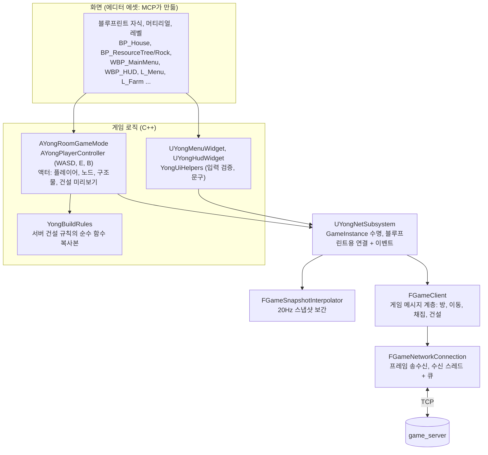

# Unreal 클라이언트 구조와 MCP 작업 방식

Unreal 클라이언트(`D:\UnrealProjects\YongClient`, UE 5.8.4)는 이 서버에 접속해 **입력을 보내고 서버가 계산한 상태를 그리기만** 한다. 이 문서는 클라이언트가 어떤 층으로 나뉘어 있는지, **Unreal MCP(에디터 자동화)에 무엇을 맡기고 무엇을 C++에 남겼는지**, 어떻게 검증했는지를 한곳에 정리한다. 접속 절차, 기준 바이트, 프로토콜 표, 겪은 문제의 상세는 [unreal-client.md](unreal-client.md)다. 그 프로젝트는 이 저장소와 별개인 로컬 git 저장소이고 원격은 없다(Content는 Git LFS).

## 1. 한눈에 보기

| 항목 | 내용 |
| --- | --- |
| 엔진 | Unreal Engine 5.8.4 (5.4.4에서 먼저 확인한 뒤 올림), MSVC 14.44 |
| 원칙 | **서버가 상태와 판정을 소유**한다. 클라이언트는 이동 방향, 채집/건설 요청만 보내고 서버 응답을 그린다 |
| 통신 | 서버와 같은 프레임 `[길이 u32][id u16][protobuf]`(big-endian), Protobuf 6.33.4를 서버와 같은 버전으로 복사해 사용 |
| 만든 것 | 메뉴(방 만들기/코드 입장), 방 안 이동(WASD), 스냅샷 보간, 탑뷰 카메라, 자원 채집(`E`), 집 짓기(`B` 건설 모드, 미리보기, 클릭 건설), HUD |
| 코드 규모 | `Source/` 아래 C++ 약 7,000줄(시험 커맨들릿 포함) |
| 시험 | 화면 없이 도는 커맨들릿 시험(진짜 서버 대상) + 변형 검증 + 에디터 두 창 접속 확인(사람) |

## 2. 계층 구조

아래에서 위로 책임이 쌓이고, 위층은 아래층의 세부(소켓, Protobuf)를 모른다.

| 층 | 클래스 | 책임 | 일부러 지킨 것 |
| --- | --- | --- | --- |
| 접속 | `FGameNetworkConnection` | TCP 연결 하나. 프레임 단위 송수신. 수신 전용 스레드가 큐에 넣고 게임 스레드가 꺼냄 | 게임 메시지를 모름. 정확히 N바이트 수신, 길이 검사 뒤에만 할당, 헤더+본문 한 번에 송신 |
| 메시지 | `FGameClient` | 방 만들기/입장/나가기, 이동 입력, 채집, 건설, 방 상태 보관, 알림 | 일반 C++ 클래스(`UObject` 아님)라 에디터 없이 커맨들릿에서 시험 가능. Protobuf는 `.cpp` 안에만 있고 헤더는 Unreal 타입만 씀. 모르는 메시지/종류는 무시 |
| 보간 | `FGameSnapshotInterpolator` | 20Hz 스냅샷 사이를 화면 프레임마다 부드러운 위치로 | 순수 계산. 시간축은 서버 틱 번호, 도착 지터는 최솟값 오프셋으로 흡수, 외삽 없음 |
| 서브시스템 | `UYongNetSubsystem` | 블루프린트에서 쓰는 연결, 이벤트, 보간된 위치 | 레벨을 옮겨도 연결과 방 상태 유지 |
| 게임 | `AYongRoomGameMode`, `AYongPlayerController` 외 | 서버 상태로 액터 생성/갱신/삭제, 입력, 건설 모드 | 위치는 서버 값, 클라이언트는 충돌을 계산하지 않음 |
| 화면 | 블루프린트 자식, UMG | 모양, 배치, 머티리얼 | **로직이 없다.** `BindWidget` 이름과 타입으로 C++와만 연결됨 |

## 3. 책임 분담: C++와 MCP

가장 중요한 규칙은 이것이다: **로직은 전부 C++, 에디터에서만 할 수 있는 일(에셋 생성, 배치, 머티리얼, 위젯 트리)은 MCP가 맡는다.** 이유는 세 가지다.

1. 시험할 수 있다. C++ 로직은 커맨들릿으로 진짜 서버에 붙여 자동 시험하고 변형 검증까지 한다. 블루프린트 그래프에 들어간 로직은 이렇게 시험하기 어렵다.
2. 되돌릴 수 있다. 에셋은 LFS에 올라가는 바이너리라 diff로 검토할 수 없다. 에셋에 로직이 없으면 잘못돼도 모양만 틀리다.
3. 접점이 작다. C++ 쪽은 `UCLASS(Abstract)` 부모, `BindWidget`/`BindWidgetOptional` 이름, `UPROPERTY` 배열(`MeshVariants`)만 약속하면 되고, MCP 작업 목록은 그 약속의 구현이다.

### 한 조각을 만드는 순서 (채집과 집 짓기가 같은 순서)

| 단계 | 누가 | 에디터 | 내용 |
| --- | --- | --- | --- |
| S0 | Claude (서버 C++) | 무관 | 프로토콜, 서버 로직, 시험과 변형 검증, `game_client` 명령, 문서. `ctest` 통과까지 |
| S1 | Claude (Unreal C++) | **닫음** | 생성 코드, 메시지 계층, 서브시스템, 액터, 게임 모드, 컨트롤러, 선택 위젯, 커맨들릿 시험 |
| S2 | **MCP 세션** | **엶** | 에셋과 레벨 작업(아래 목록) |
| S3 | 사람 | 엶 | PIE로 확인, 이상 시 증상 전달 |

**왜 번갈아 해야 하는가:** C++ 빌드는 에디터가 꺼져 있어야 하고(Live Coding이 막음), MCP는 에디터가 켜져 있어야 한다. 그래서 C++ 단계(S0, S1)를 에디터를 닫은 채로 끝까지 하고, 끝나면 MCP 작업을 한 번에 넘기는 흐름이다. 이 순서를 어기면 빌드가 막히거나 MCP가 존재하지 않는 클래스를 참조한다.

**S1에서 MCP를 위해 해 둔 일:** 필수 위젯 이름을 늘리면 `WBP_HUD`가 MCP 작업 전까지 컴파일 실패하므로, 새 위젯(`WoodText`, `StoneText`, `HintText`, `BuildCostText`, `BuildHintText`)은 `BindWidgetOptional`로 만들어 에셋이 없어도 빌드가 깨지지 않게 했다. 값이 없는 에셋(메시, 머티리얼)은 엔진 기본 큐브와 색 값으로 대체되게 해서 MCP 작업 전에도 게임이 돌게 했다.

### MCP가 만든 것

변경 이력은 Unreal 저장소의 커밋에 "(MCP 세션 작업)"으로 남아 있다.

| 조각 | MCP가 한 일 | 커밋 |
| --- | --- | --- |
| 메뉴/기반 | 메뉴 레벨 `L_Menu`, `BP_MenuGameMode`(`MenuWidgetClass = WBP_MainMenu`), `BP_YongPlayer`, `BP_YongRoomGameMode`, `WBP_MainMenu`/`WBP_HUD` 위젯 트리와 입력칸 색 조정, 머티리얼(`M_Ground`, `M_PlayerBody`, `M_Wall`), 플레이 레벨 `L_Farm`에 Kenney 메시 소품 배치 | `6c30edb` |
| 자원 채집 | `BP_ResourceTree`, `BP_ResourceRock`(부모 `AYongResourceNodeActor`, `MeshVariants` 설정, 충돌 없음, cm 기준 크기 보정), **`L_Farm`에 손으로 배치한 나무/돌 제거**(서버가 위치를 정하므로 남기면 "채집되지 않는 나무"가 생김), `WBP_HUD`에 인벤토리/힌트 위젯 추가, `BP_YongRoomGameMode`에 노드 클래스 연결 | `11c69d5` |
| 집 짓기 | `BP_House`, `BP_BuildGhost`, 머티리얼 3개(`M_House`, `M_BuildGhostValid`, `M_BuildGhostInvalid`), 게임 모드의 `HouseClass`/`BuildGhostClass` 연결, `WBP_HUD`에 건설 비용/안내 위젯 추가 | `541afde` |

MCP 서버는 Epic의 실험 기능 플러그인(`ModelContextProtocol`, `EditorToolset`)이 에디터 안에서 `http://127.0.0.1:8000/mcp`로 연다. 에디터 상태, 액터, 에셋, 블루프린트, 레벨, 머티리얼, 메시, 오브젝트 프로퍼티 같은 툴셋을 쓸 수 있고, Claude Code는 프로젝트 폴더의 `.mcp.json`으로 연결한다(설정 방법과 도구 범위는 [unreal-client.md](unreal-client.md)의 "Unreal MCP").

**MCP를 쓰면서 지킨 안전 규칙:**

- **인증이 없는 로컬 HTTP 서버**다. `127.0.0.1`에만 열고(`DefaultBindAddress`) 쓰지 않을 때는 에디터를 닫는다. 이 PC의 다른 프로그램도 이 포트로 에디터를 조작할 수 있다는 점을 문서에 적어 두었다.
- 애셋을 만들기 **전에** Unreal 저장소의 `.gitattributes`(Git LFS)를 커밋해 둔다. 안 그러면 큰 바이너리가 일반 git 객체로 들어간다.
- MCP가 한 일은 사람이 PIE로 확인하기 전까지 "완료"로 적지 않는다(아래 4절).

## 4. 어떻게 검증했는가

| 방법 | 대상 | 확인하는 것 |
| --- | --- | --- |
| 커맨들릿 시험(`-run=GameClientSpike -mode=...`) | C++ 계층 전체 | 화면 없이(`-nullrhi`) 진짜 `game_server`에 접속해 판정. 모드별 건수는 `interp` 21, `real` 53, `subsystem` 19, `gather` 40, `subsystem-gather` 25, `buildrules` 25, `build` 35, `ui` 21, `fake` 7, `garbage` 7, `subsystem-fake` 6 (문서 기준, 시험을 늘리며 바뀐 값) |
| 가짜 서버(`Tools/fake_server.py`) | 접속/메시지 계층의 나쁜 입력 | 1바이트씩 쪼갠 프레임, 두 프레임 붙여 보내기, 최대 크기 본문, 규약 밖 길이, 해석 못 하는 스냅샷 |
| 변형 검증 | 시험 자체 | 코드를 일부러 망가뜨려 시험이 잡는지: 접속 4, 메시지 계층 9(8 잡음, 1 시험 불가), 보간/서브시스템 10, UI 5, 채집 8, 건설 10 |
| PIE 두 창(사람) | 월드가 필요한 부분 | 방 만들기, 코드 입장, 한 방에 여러 플레이어가 보이는 흐름 (서버를 켜고 Number of Players 2, Net Mode `Play Standalone`, "Run Under One Process" 끔) |

좋았던 점과 못 잡은 것을 같이 적는다.

- **"걸어가서 친다"가 시험 시나리오다.** 채집/건설 시험은 서버 판정을 흉내 내지 않고, 가까운 나무까지 **실제로 이동 입력을 보내 걸어가** 목재 20, 석재 10을 모은 뒤 짓는다. 서버 거리 판정, 이동, 충돌, 방 전원의 알림이 한 번에 확인된다. 집 한가운데로 걸어도 몸이 발자국 안으로 들어가지 못하는지도 확인한다.
- **클라이언트의 판정 미리보기와 서버 판정이 일치하는지**를 `build` 시험이 확인한다(클라이언트가 "지을 수 있다"고 본 자리에 서버도 짓는지). `YongBuildRules`는 서버 규칙의 복사본이라서 어긋나면 서버가 기준이다.
- **보간기의 지터 시험:** 오프셋을 최솟값 대신 마지막 값으로 바꾸면 프레임당 이동 편차가 7.4 cm로 커져 실패한다. 보간 없이는 스냅샷마다 15 cm씩 점프하지만, 서브시스템 시험에서 약 4 ms 간격으로 읽은 최대 이동은 1.94 cm였다.
- **처음 만든 시험이 버그를 못 잡은 사례:** 송신을 헤더와 본문으로 나눠 보내는 버그는 "왕복 지연" 시험이 못 잡았다(루프백은 ACK가 즉시 와서 지연이 안 생김). 그래서 "프레임 20개가 한 번의 수신으로 도착하는가"를 보는 `send` 모드를 만들었고, 고친 코드는 20/20, 되돌린 코드는 0/20이었다.
- **시험이 거짓으로 통과한 사례:** 변형 검증 도구가 로그의 한글을 잘못 읽어 "잡힘"이라고 거짓 보고했다. 통과 건수가 0으로 찍힌 것을 보고 알아차려 인코딩을 고치고 전부 다시 돌렸다.

**아직 확인하지 못한 것:** 노드/구조물 액터의 모양, 건설 모드의 마우스 입력(땅 좌표 계산, 클릭), `E` 입력과 목표 선택, HUD 표시는 컴파일까지만 자동 확인했고 월드와 창이 필요한 부분이다. 3~4명 동시 접속, 방장 변경 화면, 서버 종료 시 메뉴 복귀, 패키징한 빌드는 시험하지 않았다. 채팅 메시지는 컴파일만 되고 Unreal에서 보내 본 적이 없다.

### 계정과 로그인 (P3)

서버의 계정/농장 저장에 맞춰 같은 순서(S0 서버 → S1 Unreal C++ → S2 MCP → S3 사람)로 진행했다. **S1(C++와 커맨들릿 시험, 변형 검증 21가지)과 S2(`WBP_MainMenu`/`WBP_HUD`에 위젯 추가)는 끝났고, S3(PIE 확인)는 진행 중이다.** S3에서 사람이 "농장을 다시 열면 목재/석재가 0으로 보임"을 찾았다. 서버는 값을 복원했지만 입장 응답에 담지 않았고, 기존 시험은 서버 값을 채집 응답으로만 확인해서 이 빈틈을 놓쳤다. 응답에 인벤토리를 더해 고쳤다. 로직은 전부 C++에 있고(`FGameClient`의 계정 요청, `UYongNetSubsystem`, `YongUi::` 규칙 함수, 메뉴/HUD 위젯 클래스), 블루프린트는 위젯 이름과 타입만 맞춘다. 새 위젯은 모두 `BindWidgetOptional`이라 MCP 작업 전에도 빌드가 깨지지 않고 게스트 흐름은 그대로 동작한다. 상세와 MCP 작업 목록, 사람이 확인할 것은 [unreal-client.md](unreal-client.md)의 "계정과 로그인 (Unreal)"이다.

## 5. 겪은 문제 (요약)

상세는 [unreal-client.md](unreal-client.md)의 "겪은 문제"다.

| 문제 | 원인 | 해결 |
| --- | --- | --- |
| 5.4에서 Protobuf 빌드가 MSVC 14.38/14.40에서 실패 | 14.38은 x64 라이브러리가 없는 불완전 설치 | 서버용으로 14.44로 빌드한 Protobuf를 복사해 사용. 5.8로 올리며 우회 세 가지를 제거 |
| Abseil `btree.h`에서 `verify()` 컴파일 오류 | Unreal이 `verify`, `check` 매크로를 정의 | Protobuf 포함 구간에서 매크로를 잠시 해제 |
| 두 `.pb.cc`를 한 파일에 합치면 오류 | 생성 코드의 익명 이름공간과 `init_seg` | 파일마다 래퍼를 따로 둠 |
| 수신 중 프레임이 쪼개져 오면 연결을 끊음 | `Recv`가 요청보다 적게 돌려줄 수 있음 | 정확히 N바이트가 모일 때까지 반복(`RecvExact`) |
| 서버가 조용하면 `Disconnect`가 멈춤 | 수신 스레드의 무한 대기 | 0.1초마다 중지 요청 확인 |
| 최대 크기 프레임에서 버퍼 넘침 | 고정 버퍼 65,530바이트 | 길이(2~65,536) 검사 뒤 그 크기만큼 동적 할당 |
| `-host=127.0.0.1`이 `127`로 잘림 | PowerShell이 인자를 점에서 쪼갬 (처음엔 Unreal 파서 탓으로 오해) | 작은따옴표로 감쌈 |
| 종료 코드가 항상 1 | `AllToolsets` 플러그인이 시작 때 `GameFeatureData` 오류 2건을 냄 | 시험 판정을 로그의 `[통과]/[실패]`와 `결과:` 줄로 함 |

## 6. 진행 중이거나 남은 것

- **미니맵(`UYongMinimapWidget`)**: 서버 위치를 읽기만 하는 UMG 위젯을 C++로 만들고 `WBP_HUD`에 붙이는 작업이 Unreal 저장소에 **커밋되지 않은 채** 있다. 시험과 PIE 확인을 하지 않았으므로 완료로 적지 않는다.
- 에디터 쪽 확인(채집/건설 액터, 건설 모드 마우스 입력, HUD)과 Kenney 메시의 출처, 라이선스 확인.
- 접속을 비동기로 바꾸기(지금은 `Connect`가 제한 시간만큼 게임 스레드를 막음).
- 게임 기본 맵 설정과 패키징.
- 다음 콘텐츠 조각(하루/시간, 농사)은 [content-roadmap.md](content-roadmap.md)의 순서를 따른다.
